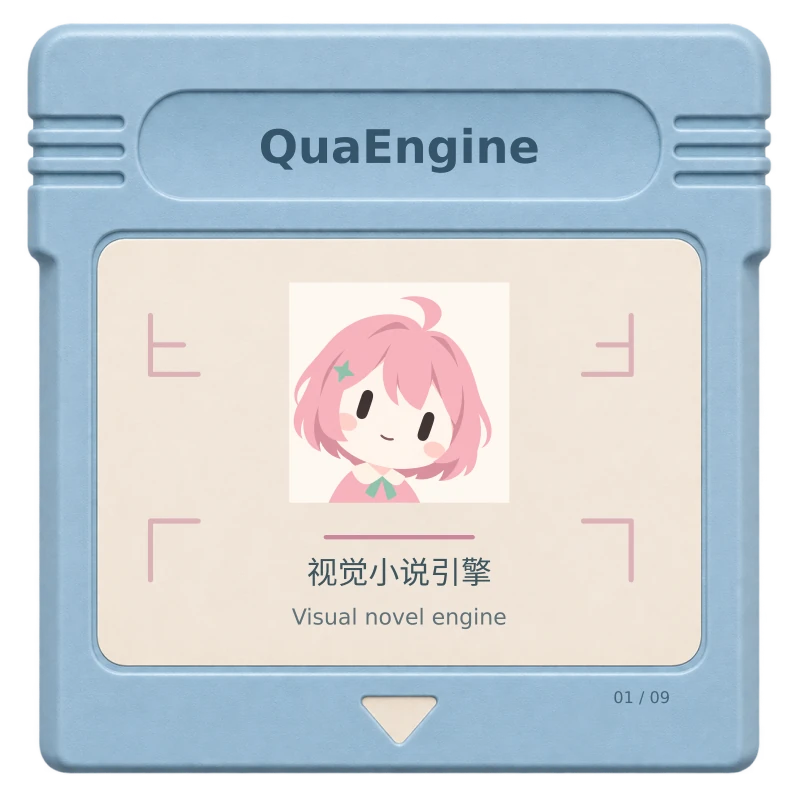
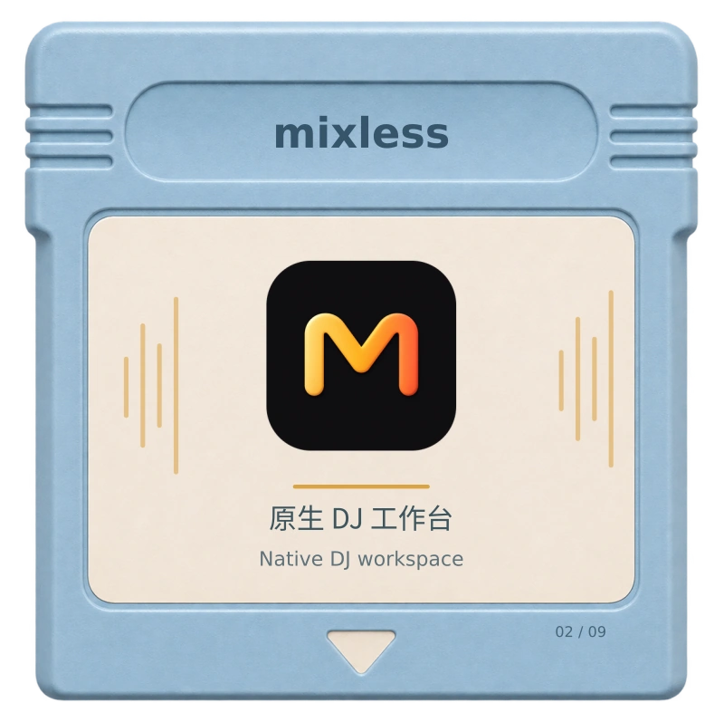
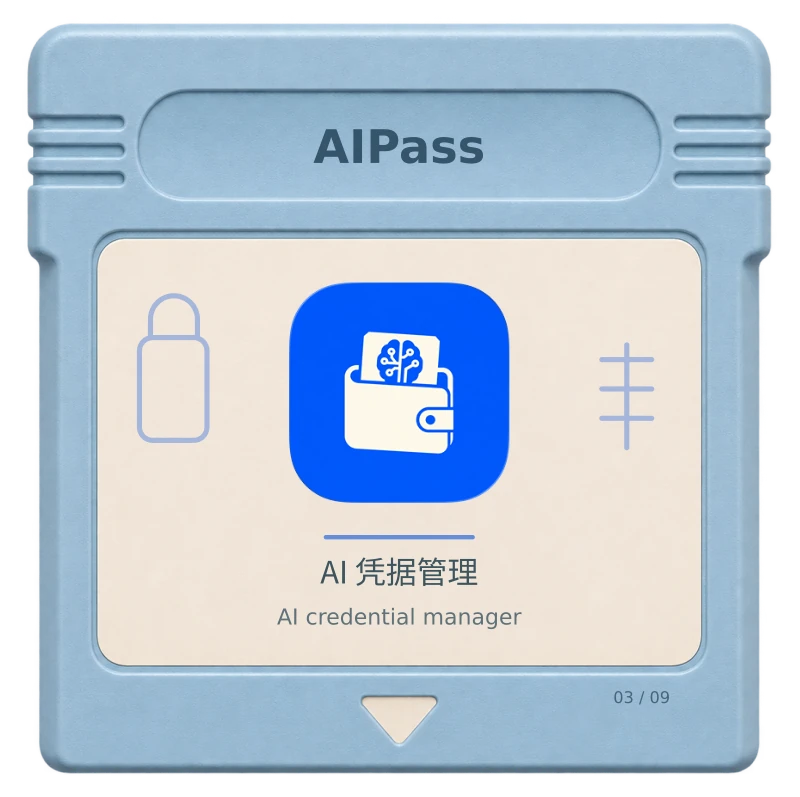
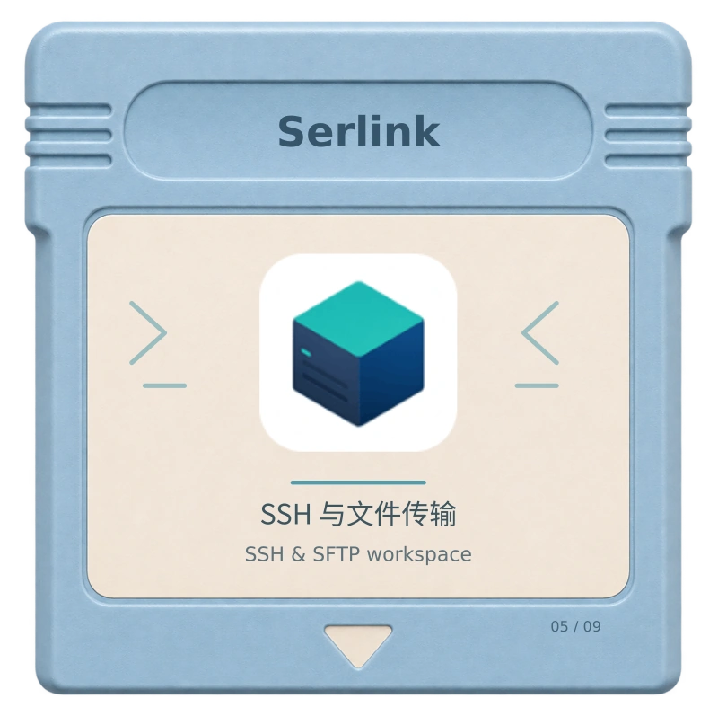
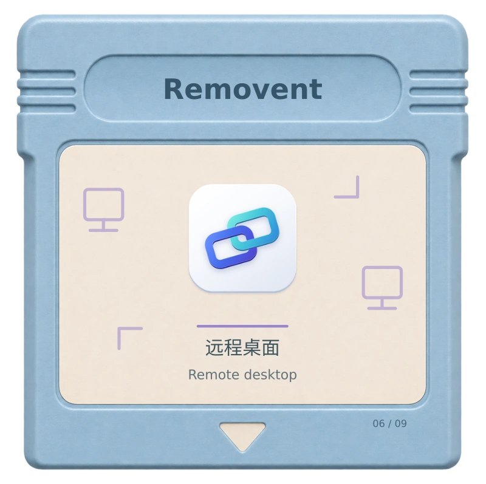
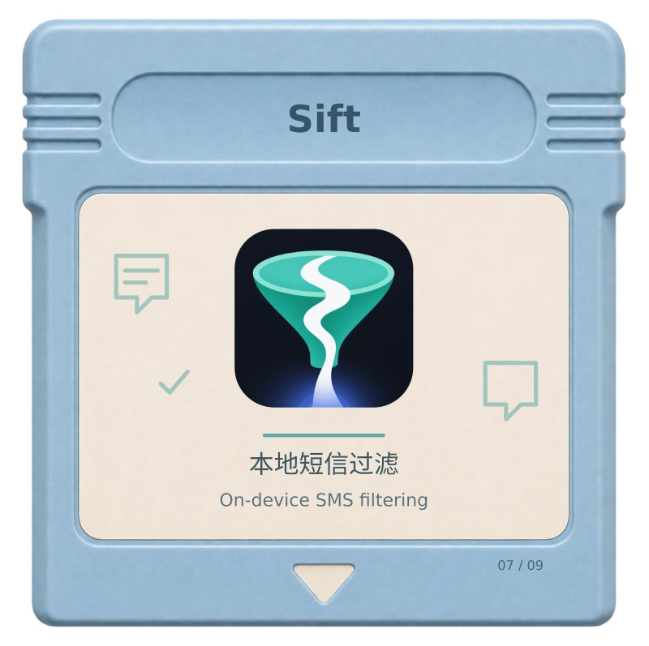
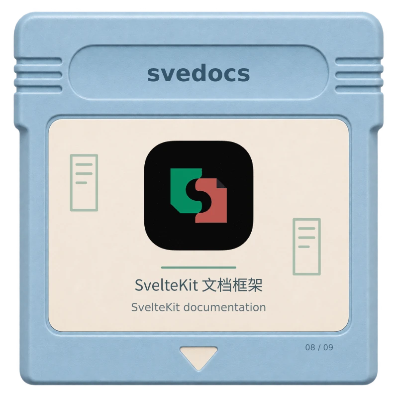
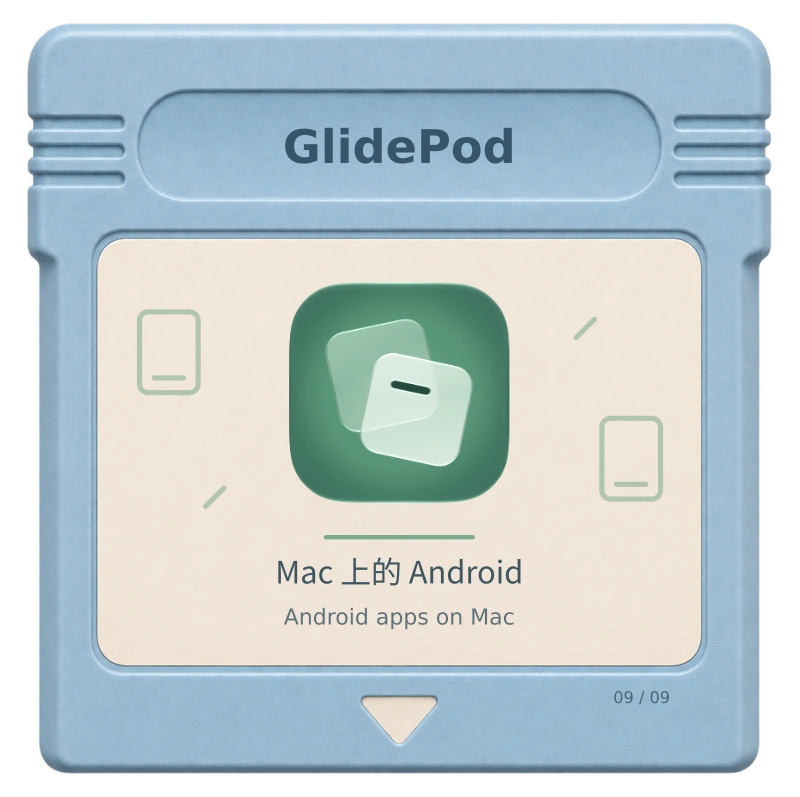

<a href="./README.md">简体中文</a> · English

  

# Hi, I'm BackRunner 👋

I build tools I'd like to use myself, care about the details of an interface, and leave room for curious ideas.

This is a collection of my independent products, open-source projects, and a small corner of the web. Feel free to explore or say hello.

[Find me on the Fediverse](https://pwp.space/@backrunner) · [Email me](mailto:dev@backrunner.top)

## My project tray

Nine projects, each with its own cartridge. Click a cartridge or project name to explore its repository.

  
  
  
   
  
  
  
   
  
  
  

- **[QuaEngine](https://github.com/QuaDevTeam/QuaEngine)** · A visual novel engine with QuaScript stories, TypeScript logic, and an Electron authoring workspace.
- **[mixless](https://github.com/backrunner/mixless)** · Dual decks, AutoMix, and local AI audio analysis for mixing your own music.
- **[AIPass](https://github.com/backrunner/aipass)** · A local encrypted vault for AI provider keys and supported subscriptions, shared across desktop, CLI, and browser workflows.
- **[SkillsCat](https://github.com/SkillsCat/skillscat)** · An open registry and CLI for discovering, publishing, and installing AI agent skills.
- **[Serlink](https://github.com/backrunner/Serlink)** · A private workspace for SSH sessions, SFTP transfers, and server connections. In development; public production builds are not ready yet.
- **[Removent](https://github.com/backrunner/removent)** · Remote desktop over your LAN or a self-hosted relay, with iPhone and iPad controllers for Macs.
- **[Sift](https://github.com/backrunner/sift)** · On-device SMS classification and filtering for iPhone. Pre-release; not on the App Store yet.
- **[svedocs](https://github.com/backrunner/svedocs)** · A SvelteKit-native docs framework with content, navigation, search, and Ask AI. In active development.
- **[GlidePod](https://github.com/backrunner/glidepod)** · Android apps in independent windows on Apple Silicon Macs. Experimental developer preview; requires a separately prepared runtime.

## How I build

I'm interested in interface design, AI tools, and the independent web. I like making complicated workflows easier to understand and use.

My usual tools include TypeScript, Svelte, Next.js, Vue, Cloudflare, Swift, and Flutter. The choice depends on the problem.

## Say hello

Building a small tool, exploring AI agents, working on the front end, or running your own community? I'd be happy to compare notes. Project suggestions are also welcome in the relevant repository's issues.

[dev@backrunner.top](mailto:dev@backrunner.top) · [@backrunner@pwp.space](https://pwp.space/@backrunner)

Encrypted contact

[OpenPGP key E06B8067F7F8FD31](https://keyserver.ubuntu.com/pks/lookup?search=E06B8067F7F8FD31&fingerprint=on&op=index)

