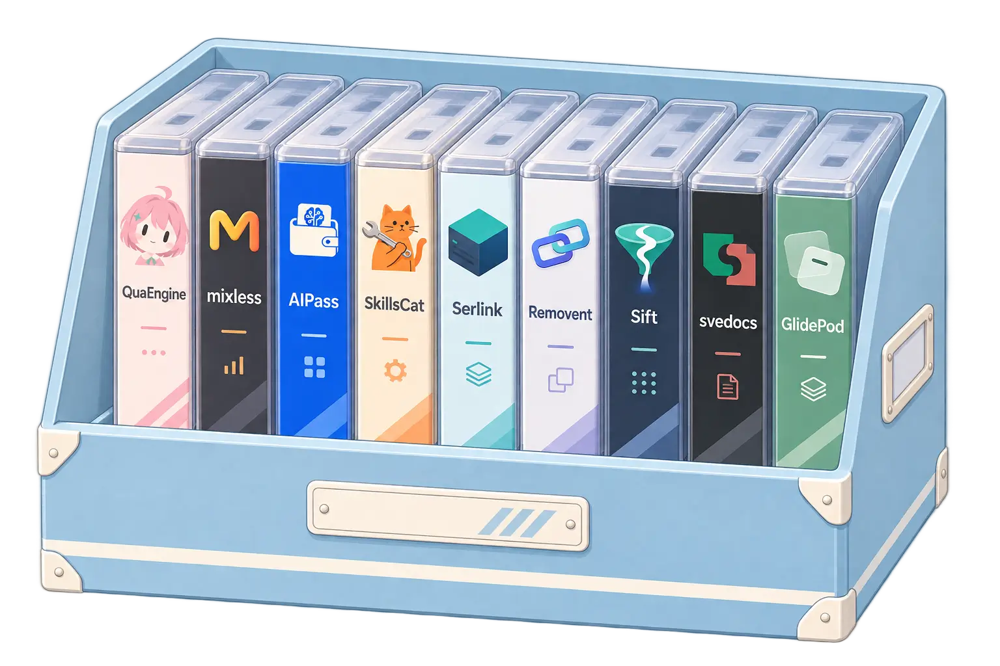

简体中文 · <a href="./README.en.md">English</a>

  

# 你好，我是 BackRunner 👋

做一些自己也想用的工具，认真打磨界面，也给有趣的想法留点位置。

这里放着我的独立产品、开源项目，以及一小片自己的互联网。可以看看作品，也欢迎来聊聊。

[在联邦宇宙找到我](https://pwp.space/@backrunner) · [发封邮件](mailto:dev@backrunner.top)

## 我的项目磁带盒

把正在做的项目收进一个磁带盒。下方每个项目名都可以点击，打开对应仓库。

  

- **[QuaEngine](https://github.com/QuaDevTeam/QuaEngine)** · 用 QuaScript 和 TypeScript 编写故事、分支与演出，搭配 Electron 创作工作台。
- **[mixless](https://github.com/backrunner/mixless)** · 双唱盘、自动混音与本地 AI 音频分析，把自己的音乐连成一场演出。
- **[AIPass](https://github.com/backrunner/aipass)** · 把 AI 服务密钥与支持的订阅账户放进本地加密保险库，连接桌面、CLI 和浏览器工作流。
- **[SkillsCat](https://github.com/SkillsCat/skillscat)** · 发现、发布和安装 AI Agent 技能的开放平台与命令行工具。
- **[Serlink](https://github.com/backrunner/Serlink)** · 整理 SSH 会话、SFTP 传输和服务器连接的私密工作台。开发中，公开正式版本尚未就绪。
- **[Removent](https://github.com/backrunner/removent)** · 通过局域网或自建中继连接远程桌面，也可用 iPhone、iPad 控制 Mac。
- **[Sift](https://github.com/backrunner/sift)** · 在 iPhone 本地分类和过滤短信。开发中，尚未上架 App Store。
- **[svedocs](https://github.com/backrunner/svedocs)** · 面向边缘部署的 SvelteKit 原生文档框架，整合内容、导航、搜索与 Ask AI。开发中。
- **[GlidePod](https://github.com/backrunner/glidepod)** · 在 Apple Silicon Mac 的独立窗口中运行 Android 应用。实验性开发者预览，需另行准备运行环境。

## 关于做东西

我关注界面设计、AI 工具和独立互联网。比起堆满功能，更希望把复杂的事情理顺，让工具用起来清楚、顺手。

常用 TypeScript、Svelte、Next.js、Vue、Cloudflare、Swift 和 Flutter。具体用什么，还是看要解决什么问题。

## 来聊聊

如果你也在做小工具、研究 AI Agent、折腾前端，或经营自己的社区，欢迎交流。对项目有建议，也可以到对应仓库提 Issue。

[dev@backrunner.top](mailto:dev@backrunner.top) · [@backrunner@pwp.space](https://pwp.space/@backrunner)

加密联系

[OpenPGP 公钥 E06B8067F7F8FD31](https://keyserver.ubuntu.com/pks/lookup?search=E06B8067F7F8FD31&fingerprint=on&op=index)

